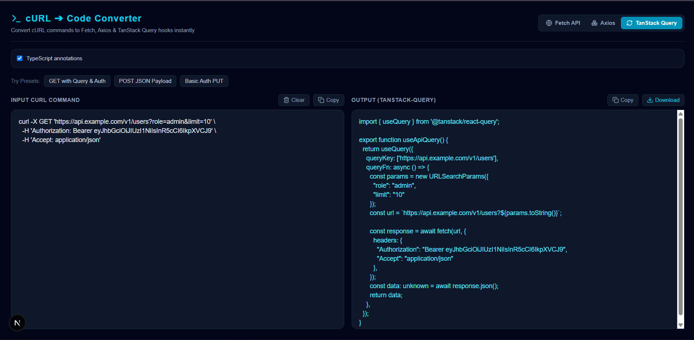

# ⚡ cURL to Fetch, Axios & TanStack Query Converter

A fast, developer-focused micro-tool designed to convert raw terminal or Chrome DevTools `curl` commands into clean, production-ready **JavaScript Fetch API**, **Axios**, and **TanStack Query (React Query)** hooks.

Built with a custom state-machine tokenizer and 100% client-side execution so your API keys, bearer tokens, and payloads never leave your browser.

 <!-- Simpan screenshot aplikasi di folder /public -->

---

## ✨ Features

- 🔒 **100% Client-Side & Privacy-First:** Zero network requests. Sensitive headers like `Authorization: Bearer ...` and `-u` Basic Auth credentials are processed entirely in browser memory.
- 🧠 **Custom cURL Lexer & Tokenizer:** Parses multi-line commands (`\` for Unix/macOS and `^` for Windows CMD), handles single/double quote escaping, extracts URL query parameters into `URLSearchParams`, and auto-detects JSON bodies.
- ⚡ **Multi-Target Code Generation:**
  - **Fetch API:** Clean `async/await` or `.then()` chains with optional `try/catch` and `response.ok` error handling.
  - **Axios:** Structured `axios.request()` config with separated `params`, `headers`, and `data`.
  - **TanStack Query:** Automatically generates `useQuery` hooks for `GET` requests and `useMutation` hooks for `POST`, `PUT`, `PATCH`, and `DELETE`.
- 🔷 **TypeScript Ready:** Toggle TypeScript type annotations and export directly as `.ts` or `.js` files.
- 💾 **State Persistence:** Automatically saves your active cURL input and generator options using `useSyncExternalStore` and `localStorage`.

---

## 🛠️ Tech Stack

- **Framework:** Next.js (App Router)
- **Language:** TypeScript
- **Styling:** Tailwind CSS
- **Icons:** Lucide React
- **Parser Engine:** Custom State-Machine Tokenizer (Zero external parser dependencies)

---

## 🚀 Getting Started

### 1. Clone the repository
```bash
git clone [https://github.com/EghoPratama/curl-to-code.git](https://github.com/EghoPratama/curl-to-code.git)
cd curl-to-code